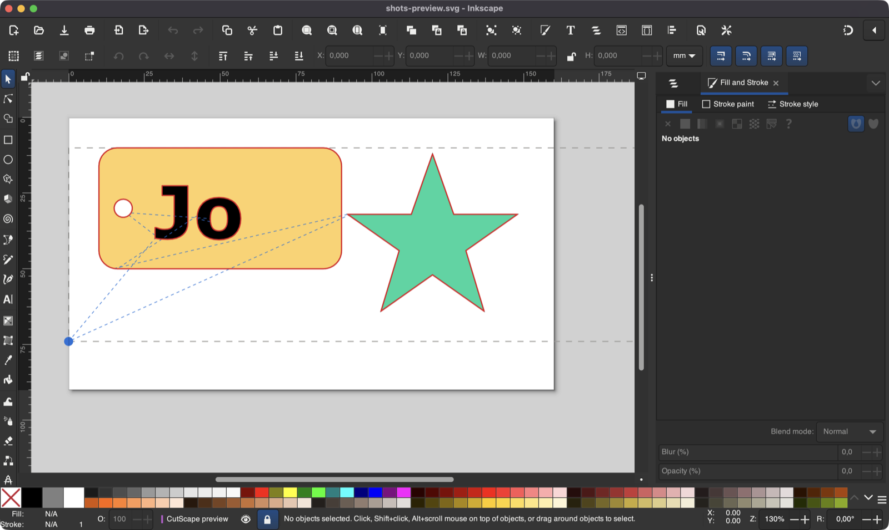
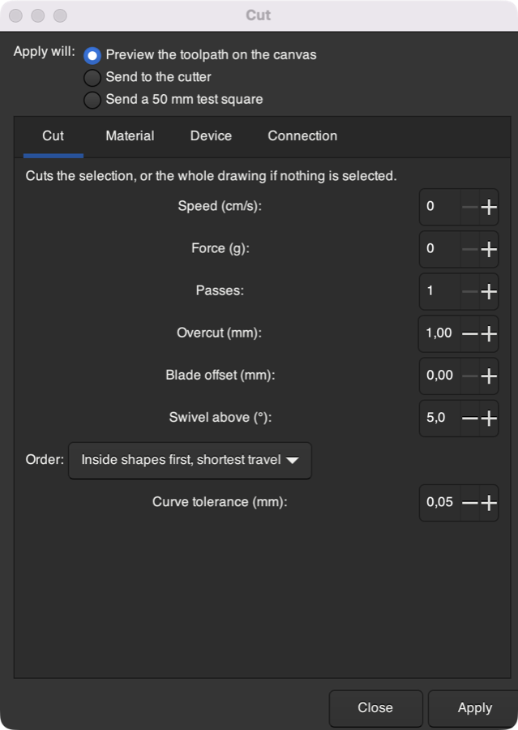
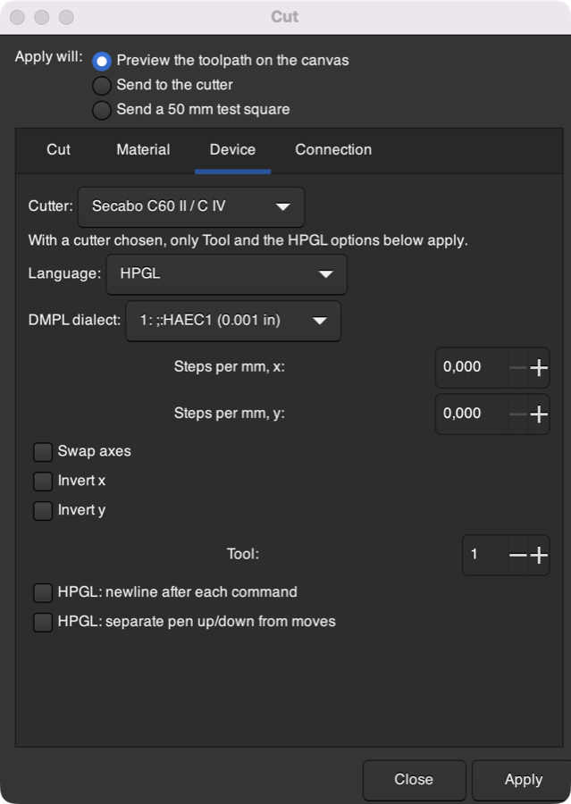
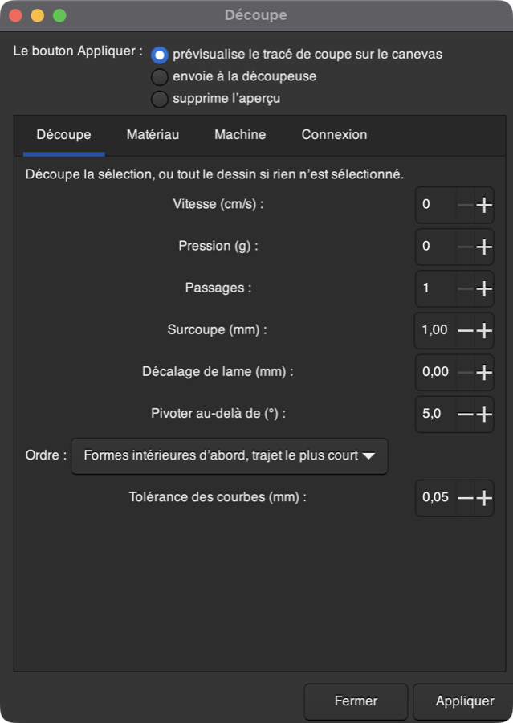

# CutScape

Send drawings from Inkscape straight to a vinyl cutter or plotter.

CutScape is an **Inkscape extension, not an app**. You don't launch anything
separately. It adds **Extensions → CutScape → Cut…** to Inkscape, where you
preview the toolpath on your canvas and then send it to the cutter. It runs on
the Python that ships with Inkscape, so there is no Qt, no virtualenv and nothing
to `pip install`.

*En français :* CutScape est une extension Inkscape, pas une application. Son
interface est en français quand Inkscape l’est.



> **Status: prototype (0.1).** Written for Inkscape 1.4 and 1.5. So far it has
> been run in Inkscape 1.4 on macOS, with output checked against files, but
> not yet on a real cutter. The HPGL it sends matches what Inkcut sent to a
> Secabo C IV. Please open an issue with what works on your cutter, or what
> doesn't.

## Install

You need Inkscape 1.4 or newer.

1. Download `cutscape-0.1.0.zip` from the
   [Releases page](https://github.com/jetpax/CutScape/releases/latest).
2. In Inkscape, open **Edit → Preferences → System**. Next to
   **User extensions**, click **Open** to show the folder.
3. Unzip the download into that folder. You should end up with
   `extensions/cutscape/cutscape_cut.inx`.
4. Restart Inkscape.

The user extensions folder is usually:

| System | Folder |
|---|---|
| Linux | `~/.config/inkscape/extensions` |
| Linux, Flatpak | `~/.var/app/org.inkscape.Inkscape/config/inkscape/extensions` |
| Linux, Snap | `~/snap/inkscape/current/.config/inkscape/extensions` |
| macOS | `~/Library/Application Support/org.inkscape.Inkscape/config/inkscape/extensions` |
| Windows | `%APPDATA%\inkscape\extensions` |

**For every account on a Linux machine,** unzip into
`/usr/share/inkscape/extensions` instead, using `sudo`.

**Serial cutters** need pyserial. It ships with Inkscape on Windows and macOS.
On Linux, run `sudo apt install python3-serial` or your distribution's
equivalent. Nothing else is needed.

## Use

1. Select what you want to cut. If nothing is selected, the whole drawing is
   cut. Hidden objects are skipped, and text is converted to paths for you;
   your document isn't changed.
2. Open **Extensions → CutScape → Cut…**
3. On **Device**, pick your cutter. On **Connection**, say how it's attached
   (see below). Inkscape remembers both.
4. Choose **Preview the toolpath on the canvas** and click **Apply**.
   - Red lines are cuts.
   - Dashed blue lines are moves with the blade up.
   - The blue dot is the cutter's origin.
   - Grey dashes mark the edge of the material.

   The preview goes on a locked layer called *CutScape preview*, which is
   never cut. **Remove the preview** (or Ctrl+Z) takes it away.
5. Choose **Send to the cutter** and click **Apply**.

To send again with the same settings, use **Extensions → Previous Extension**.

<p>
  
  
</p>

### What the settings do

| Tab | Setting | |
|---|---|---|
| Cut | Speed, Force | Sent to the cutter. 0 leaves the cutter's own setting. |
| | Passes | Cut everything this many times. Closed shapes are cut as one continuous loop. |
| | Overcut | Run past the start of closed shapes so the ends meet (1 mm by default). |
| | Blade offset | Drag-knife correction: about 0.25 mm for a 45° blade, 0.5 mm for 60°. Leave at 0 if your cutter corrects for it itself. |
| | Order | *Inside shapes first* cuts holes and letter counters before their outlines, so pieces don't shift, and keeps blade-up travel short. |
| Material | Width, Length | Size of the material. 0 width uses the cutter's width; 0 length means a roll. x runs across the material, y along the feed. |
| | Move the job to the origin | Otherwise the job keeps its place relative to the page's bottom-left corner. |
| | Rotate 90°, Mirror | Mirror for heat-transfer vinyl, which is cut from the back. |
| | Copies, Weed line | Repeat the job across the material, and draw a box around it for weeding. |
| | Pre-feed | Pull the job's length of material through and back first, so a roll tracks straight. |
| | Feed past the job | Where the head parks when it's done. 0 returns it to the origin. |
| Device | Cutter | A preset for your model, or *Custom* to set the command language (HPGL, DMPL, GP-GL, CAMM-GL, G-code), resolution and axes yourself. |
| Connection | Send through | A printer queue, a device file, a serial port, or a file to check the output. |

## Languages

CutScape follows Inkscape's language (**Edit → Preferences → Interface →
Language**). It's available in English and French:



To add a language:

1. Copy `po/cutscape.pot` to `po/<code>.po`, for example `po/de.po`.
2. Translate it in any PO editor.
3. Run `python3 tools/i18n.py compile` and commit the `.po` and the
   generated `extension/locale/<code>/LC_MESSAGES/cutscape.mo`.

After changing any text in the dialog or the code, run
`python3 tools/i18n.py extract` to update the template and the existing
translations.

## Connecting your cutter

**USB cutters on Linux.** Most HPGL cutters present themselves as USB printers.
The simplest setup is a *raw* CUPS queue, which passes the commands through
untouched. Find the cutter's URI, then create the queue:

```bash
lpinfo -v | grep usb
```

```bash
sudo lpadmin -p cutter -E -v 'usb://YOUR/CUTTER?serial=…' -m raw
```

In CutScape, choose **Printer queue** and enter `cutter`. If you leave the queue
empty and click Apply, CutScape lists the queues it can see. To check the queue
without Inkscape, this should cut a 50 mm square:

```bash
printf 'IN;PU0,0;PD2000,0,2000,2000,0,2000,0,0;PU0,0;' | lp -d cutter -o raw
```

The cutter must be online (check its panel), or CUPS waits at
"Sending data to printer".

Alternatively, choose **Device file** and enter `/dev/usb/lp0`. Your account
needs to be in the `lp` group for that: run `sudo usermod -aG lp $USER`, then
log out and back in.

**Serial and USB-serial cutters.** Choose **Serial port** and enter the port:
`/dev/ttyUSB0` on Linux, `/dev/cu.usbserial-…` on macOS, `COM3` on Windows. Set
the baud rate and flow control from the cutter's manual. G-code controllers such
as GRBL are fed one line at a time, waiting for each `ok`.

**Windows printer queues** need pywin32. They are untested.

**Not supported yet:** Silhouette cutters over USB (they aren't USB printers),
and Bluetooth.

## Troubleshooting

- **Converting text is slow.** CutScape starts a second, hidden Inkscape to turn
  text into paths, which can take a while, especially the first time. Converting
  the text yourself first (**Path → Object to Path**) avoids that.
- **Inkscape crashes as soon as any extension runs on macOS.** This happens if
  Inkscape was started from a terminal with a very high open-files limit
  (`ulimit -n`). GLib, which Inkscape uses to start extensions, runs out of stack
  while walking every possible file descriptor. Start Inkscape from the Dock or
  Finder instead, or run `ulimit -n 10240` first.
- **Nothing happens on the cutter.** Check that it's online, try the
  50 mm square test above, and set **Send through: File** to look at what
  CutScape produces.

## Supported cutters

The **Cutter** list holds presets for ANAgraph, Creation, GCC, Graphtec, Ioline,
KNK, Mimaki, Redsail, Rheinstern, Roland, Secabo, SeikiTech, Sekonic, Silhouette,
Summa, US Cutter, VEVOR and Vision models. Any HPGL or DMPL cutter should work
with *Custom*.

The orientation of the Roland Stika and Silhouette presets was converted from
Inkcut and hasn't been checked against the machines. Do a small test cut first.

## Inkscape 1.5

CutScape runs on Inkscape 1.4 and is ready for 1.5, which adds two
extension features:

- **Run without the dialog:** every extension gets
  `io.github.jetpax.cutscape.cut.noprefs` and `….prefs` actions. A keyboard
  shortcut or a script can send with saved or given settings without opening the
  dialog.
- **Live preview:** extensions that keep running and receive document changes
  are planned to drive a toolpath preview that updates as you edit.

## Development

```
extension/              what gets installed (zip it with tools/package_extension.py)
  cutscape_cut.inx      the dialog
  cutscape_cut.py       the Inkscape effect
  cutscape/             the cutting core: plain Python, no Inkscape or Qt needed
    geometry.py filters.py protocols.py transports.py devices.py job.py
    i18n.py
    document.py preview.py    (these two use inkex)
  locale/               compiled translations (built from po/ by tools/i18n.py)
po/                     translation sources
tests/test_cutscape_*.py
```

- **Install from a checkout:** link the folder instead of copying it, so edits
  take effect when Inkscape restarts:

  ```bash
  ln -s "$PWD/extension" ~/.config/inkscape/extensions/cutscape
  ```

- **Run the tests:**

  ```bash
  pip install inkex pytest && python -m pytest tests/test_cutscape_core.py tests/test_cutscape_extension.py
  ```

- **Run the effect without the GUI:** use Inkscape's Python with Inkscape's
  extensions folder on `PYTHONPATH`, for example:

  ```bash
  python3 extension/cutscape_cut.py --action=send --transport=file --file=out.plt drawing.svg > /dev/null
  ```

## Where this came from

CutScape is a fork of [Inkcut](https://github.com/inkcut/inkcut) by Jairus Martin
and contributors. It rebuilds Inkcut's cutting pipeline, which covers device
presets, the HPGL/DMPL/GP-GL/CAMM-GL/G-code languages, blade offset, overcut and
copies, as a Qt-free Inkscape extension.

The `inkcut/` folder still holds the original Qt application, which this fork
started from. It's kept for reference and for fixes sent upstream; you don't
need it to use CutScape.

Several upstream pull requests that were never merged are folded in:

- Creation PCut DMPL commands (inkcut/inkcut#382 by LDP-Soft)
- Pre-feed and flush-on-close (inkcut/inkcut#427) and the VEVOR presets
  (inkcut/inkcut#428), both by mcmartnor
- GP-GL command terminators and the Cameo 4 Plus (inkcut/inkcut#441 by lagnat)
- DMPL units per dialect, the Summa D760 and safer selection handling
  (inkcut/inkcut#442 by lukebmay)
- G-code line-by-line streaming (inkcut/inkcut#388 by karliss)

CutScape is licensed under the GPL v3, like Inkcut. See [LICENSE](LICENSE).
