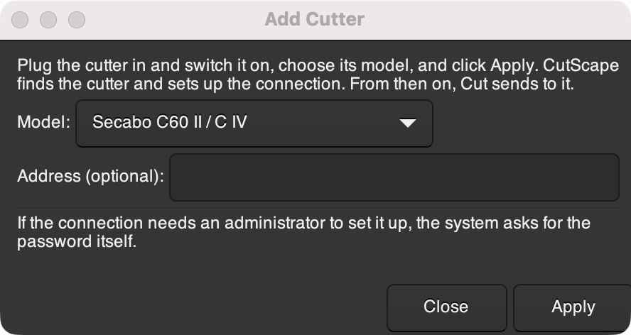

# CutScape

Send drawings from Inkscape straight to a vinyl cutter or plotter.

CutScape is an **Inkscape extension, not an app**. You don't launch anything
separately. It adds a **CutScape** submenu to Inkscape's **Extensions** menu. It
runs on the Python that ships with Inkscape, so there is no Qt, no virtualenv
and nothing to `pip install`.

| Extensions → CutScape → | |
|---|---|
| **Add Cutter…** | Find the cutter that's plugged in and set it up, so Cut can send to it |
| **Cut…** | Preview the toolpath on your canvas, send it to the cutter, send a 50 mm test square, or line up with a printed sheet and cut |
| **Add Crop Marks** | For [print and cut](#print-and-cut): hide the cut lines so they don't print, and add marks to line up with |
| **Remove Cutter…** | Forget the cutter you added |
| **Remove Preview** | Take the toolpath preview off the drawing |

*En français :* CutScape est une extension Inkscape, pas une application. Son
interface est en français quand Inkscape l’est.


> **Status: prototype (0.5).** Written for Inkscape 1.4 and 1.5. So far it has
> been run in Inkscape 1.4 on macOS, with output checked against files, but
> not yet on a real cutter. The HPGL it sends matches what Inkcut sent to a
> Secabo C IV. Please open an issue with what works on your cutter, or what
> doesn't.

## Install

You need Inkscape 1.4 or newer.

1. Download the `cutscape-….zip` file from the
   [Releases page](https://github.com/jetpax/CutScape/releases/latest).
2. In Inkscape, open **Edit → Preferences → System**. Next to
   **User extensions**, click **Open** to show the folder.
3. Unzip the download into that folder. You should end up with
   `extensions/cutscape/cutscape_cut.inx`.
4. Restart Inkscape.

The user extensions folder is usually:

| System | Folder |
|---|---|
| Linux | `~/.config/inkscape/extensions` |
| Linux, Flatpak | `~/.var/app/org.inkscape.Inkscape/config/inkscape/extensions` |
| Linux, Snap | `~/snap/inkscape/current/.config/inkscape/extensions` |
| macOS | `~/Library/Application Support/org.inkscape.Inkscape/config/inkscape/extensions` |
| Windows | `%APPDATA%\inkscape\extensions` |

**For every account on a Linux machine,** unzip into
`/usr/share/inkscape/extensions` instead, using `sudo`.

**Serial cutters** need pyserial. It ships with Inkscape on Windows and macOS.
On Linux, run `sudo apt install python3-serial` or your distribution's
equivalent. Nothing else is needed.

## Use

First, add your cutter: plug it in, switch it on, and use
**Extensions → CutScape → Add Cutter…** (see
[Connecting your cutter](#connecting-your-cutter)). You only do this once.

1. Select what you want to cut. If nothing is selected, the whole drawing is
   cut. Hidden objects are skipped, and text is converted to paths for you;
   your document isn't changed.
2. Open **Extensions → CutScape → Cut…**
3. **Device** and **Connection** are already set to *The cutter you added*.
   Change them only to use a different cutter or connection. Inkscape
   remembers what you choose.
4. Choose **Preview the toolpath on the canvas** and click **Apply**.
   - Red lines are cuts.
   - Dashed blue lines are moves with the blade up.
   - The blue dot is the cutter's origin.
   - Grey dashes mark the edge of the material.

   The preview goes on a locked layer called *CutScape preview*, which is
   never cut. **Extensions → CutScape → Remove Preview** (or Ctrl+Z) takes it
   away.
5. Choose **Send to the cutter** and click **Apply**.

To send again with the same settings, use **Extensions → Previous Extension**.

<p>
  
  
</p>

### What the settings do

| Tab | Setting | |
|---|---|---|
| Cut | Speed, Force | Sent to the cutter. 0 leaves the cutter's own setting. G-code needs a speed. |
| | Passes | Cut everything this many times. Closed shapes are cut as one continuous loop. |
| | Overcut | Run past the start of closed shapes so the ends meet (1 mm by default). |
| | Blade offset | Drag-knife correction: about 0.25 mm for a 45° blade, 0.5 mm for 60°. Leave at 0 if your cutter corrects for it itself. |
| | Order | *Inside shapes first* cuts holes and letter counters before their outlines, so pieces don't shift, and keeps blade-up travel short. |
| Material | Width, Length | Size of the material. 0 width uses the cutter's width; 0 length means a roll. x runs across the material, y along the feed. |
| | Move the job to the origin | Otherwise the job keeps its place relative to the page's bottom-left corner. |
| | Rotate 90°, Mirror | Mirror for heat-transfer vinyl, which is cut from the back. |
| | Copies, Weed line | Repeat the job across the material, and draw a box around it for weeding. |
| | Pre-feed | Pull the job's length of material through and back first, so a roll tracks straight. |
| | Feed past the job | Where the head parks when it's done. 0 returns it to the origin. |
| Device | Cutter | *The cutter you added*, a preset for your model, or *Custom* to set the command language (HPGL, DMPL, GP-GL, CAMM-GL, G-code), resolution and axes yourself. |
| | G-code: Z for travel, Z for cutting | The tool lifts to the first between cuts and lowers to the second to cut. Make them the same to send no Z moves. See [Desktop CNC machines](#desktop-cnc-machines-grbl). |
| Connection | Send through | *The cutter you added*, a printer queue, a device file, a serial port, or a file to check the output. |

## Languages

CutScape follows Inkscape's language (**Edit → Preferences → Interface →
Language**). It's available in English and French:


To add a language:

1. Copy `po/cutscape.pot` to `po/<code>.po`, for example `po/de.po`.
2. Translate it in any PO editor.
3. Run `python3 tools/i18n.py compile` and commit the `.po` and the
   generated `extension/locale/<code>/LC_MESSAGES/cutscape.mo`.

After changing any text in the dialog or the code, run
`python3 tools/i18n.py extract` to update the template and the existing
translations.

## Connecting your cutter

1. Plug the cutter in and switch it on.
2. Open **Extensions → CutScape → Add Cutter…**, choose your model, and click
   **Apply**.
3. In **Cut…**, choose **Send a 50 mm test square** and click **Apply**. It
   ignores the drawing. Measure the square to check the scale.



Add Cutter finds the cutter and sets up the best connection for your system:

- **Linux:** the cutter's USB printer device (`/dev/usb/lp0`, `lp1` and so
  on), found by its USB id, such as `usb:0483:5750`, so it still works when
  the number changes. If your account can't write to it, CutScape installs a
  udev rule (`/etc/udev/rules.d/70-cutscape.rules`) that lets whoever is
  logged in use the cutter, and also makes `/dev/cutter`.
- **macOS, or Linux through CUPS:** a *raw* printer queue called `cutter`,
  which passes the commands through untouched.
- **USB-serial cutters:** the serial port, found by its USB id. Set the baud
  rate and flow control on Cut's **Connection** tab, from the cutter's
  manual. For the *CNC 3018 (GRBL)* preset, CutScape sets 115200 baud
  itself.

If this needs an administrator, the system asks for the password in its own
prompt, and CutScape never sees it. Where there's no prompt (over SSH, say),
CutScape shows the commands to run with `sudo` instead.

**If CutScape finds more than one possible cutter,** it lists their addresses.
Enter yours in **Address** and click **Apply** again. **Address** also takes
the name of a printer queue, a device file such as `/dev/cutter`, or a serial
port such as `/dev/ttyUSB0` or `COM3`, for a cutter connected some other way.
If CutScape finds nothing, it says so, and lists any printer queues and
serial ports you could enter instead.

**If a printer queue stops,** Cut won't send to it, because the job would only
wait there. CUPS stops a queue when the cutter is off or unplugged during a
job. Run Add Cutter again: it restarts the queue and clears the stuck jobs.

**Remove Cutter…** forgets the cutter, and removes the printer queue Add
Cutter made for it. CutScape keeps the cutter you added in `cutter.json`, in
`~/.config/cutscape` on Linux, `~/Library/Application Support/CutScape` on
macOS, or `%APPDATA%\CutScape` on Windows.

### Choosing the connection yourself

Cut's **Connection** tab can send somewhere else instead:

- **Device file:** `/dev/usb/lp0`, `/dev/cutter`, or a USB id.
- **Printer queue:** a raw CUPS queue, or a Windows printer.
- **Serial port:** `/dev/ttyUSB0`, `/dev/cu.usbserial-…`, `COM3`, or a USB id.
  G-code controllers such as GRBL are fed one line at a time, waiting for
  each `ok`.
- **File:** saves the commands, to check what CutScape produces.

If the cutter stops taking data for 30 seconds (it's offline, paused or out
of material), CutScape stops with an error rather than leaving Inkscape
waiting. A printer queue can't tell: CUPS accepts the job whether or not the
cutter is online. If nothing moves, check the cutter's panel. `lpstat -o`
shows the job waiting at "Sending data to printer". CUPS also warns that raw
queues are deprecated. They still work, but on Linux the device file is
better.

**Windows:** USB-serial cutters are found as above. A cutter that connects as
a USB printer must first be added in **Settings → Bluetooth & devices →
Printers & scanners**, with the *Generic / Text Only* driver. Then enter the
printer's name in Add Cutter's **Address**. Printing on Windows needs pywin32,
and is untested.

**Not supported yet:** Silhouette cutters over USB (they aren't USB printers),
and Bluetooth.

## Print and cut

Print a design on an ordinary printer, then cut around it, for stickers and
labels. The sheet never lies exactly where the page says, so CutScape prints
four crop marks with the design. You move the head onto each one with arrow
buttons, and CutScape corrects the cut for how the sheet is shifted, turned and
stretched. This is the way Secabo's LAPOS works, and it needs no sensor.

It needs a **direct connection**, because the head moves as you click: the USB
device on Linux, which Add Cutter sets up, or a serial port. It doesn't work
through a printer queue, so not over USB on macOS or Windows yet, or with G-code
machines.

1. Draw the line to cut, with **Path → Linked Offset** around a shape or **Path →
   Trace Bitmap** for a picture, and select only that line.
2. Use **Extensions → CutScape → Add Crop Marks**. The line moves to a hidden
   layer, *CutScape cut lines*, so it won't print. Four numbered marks appear
   on a locked layer around the design.
3. Print at 100%, with no "fit to page".
4. Put the sheet in the cutter. On the cutter's panel, set its origin just outside
   the marks, at the corner where the cutter starts, so the head can reach all
   four. The head can't go past the origin.
5. Open **Extensions → CutScape → Cut…**, choose **Line up with printed crop
   marks and cut** and click **Apply**. The head goes to the origin and a window
   opens.
6. The window names the mark nearest the origin. Move onto it with the arrow
   buttons or the keyboard's arrow keys, and click **On the mark**. The head then
   goes close to the next mark by itself.
7. After the fourth mark, the window shows how the sheet lies. Click **Cut**, or
   **Back** to aim again.

**To aim with a laser,** switch it on at the cutter, usually with a **Laser**
button on its panel; CutScape can't switch it on for you. Then calibrate it once,
with scrap in the cutter: in Cut, choose **Calibrate the laser for lining up** and
click **Apply**. Any drawing will do; it needs no crop marks. Move the head over
the scrap and click **Cut the cross**, then move the laser onto the centre of the
cross, and CutScape learns how far the laser is from the blade. On a cutter with
no laser, aim with the blade tip. **If the arrows go the wrong way,** click **Turn
arrows**. CutScape remembers both.

This works with any cutter CutScape can reach directly, whatever the brand, using
its preset or *Custom* settings. The presets for **Secabo's C60 IV, C120 IV, S and
T series** know more, from the driver data Secabo's own software ships: X runs
along the feed from an origin at the front right, so x on the Material tab really
runs across the material. Load the sheet the right way up with its top going into
the cutter, and set the origin just below and to the right of mark 2, which is
where the window starts. They also start from those cutters' usual laser offset, so
the laser is roughly right before you calibrate it.

Speed, Force, Overcut, Blade offset and the other settings on Cut's first tab
still apply. The Material tab's layout options don't, because the sheet decides
where everything goes. A plain **Send to the cutter** leaves out the marks and
the hidden cut lines. To change a cut line, show its layer in **Layer → Layers and
Objects**.

This hasn't been run on a real cutter yet: only against a stand-in for one, and
the Secabo settings come from reading that software, not from testing a machine.
Try it on scrap first, with a pen if you can, and please open an issue with what
happens.

## Desktop CNC machines (GRBL)

A desktop CNC with a drag knife or a pen in the spindle clamp can cut too.
Choose the **CNC 3018 (GRBL)** preset (300 × 180 mm), or *Custom* with
**G-code** for another GRBL machine.

- **Set a speed** on the Cut tab: GRBL won't cut without a feed rate.
  1 cm/s is 600 mm/min.
- **Zero Z** where the blade should cut, or where the pen touches the paper.
  CutScape lifts to *Z for travel* (5 mm) between cuts and lowers to *Z for
  cutting* (0) to cut. For a spring-loaded knife holder, set *Z for cutting*
  a little below zero to press the blade in.
- **Corners need nothing extra.** A drag knife turns by itself. Set **Blade
  offset** and CutScape swings the tool round each sharp corner so the blade
  turns on the spot. Tangential knives, turned by a motor, aren't
  supported.
- Leave the spindle off: CutScape never starts it.

The job starts at the machine's work zero, with X to the right and Y away
from you. CutScape waits 2 seconds after opening the port, because GRBL
restarts then, and stops on the first `error` or `ALARM` it reports. This
hasn't been run on a real machine yet. Save to a **File** first to check the
G-code, then try a pen before a knife.

## Troubleshooting

- **Text takes a little longer.** CutScape converts text with a second, hidden
  Inkscape, so the cut matches exactly what Inkscape draws. That adds about
  0.2 s on a Mac. The first run on a new Inkscape profile can take much longer
  while fonts are indexed. Converting the text yourself (**Path → Object to
  Path**) skips this step.
- **Nothing happens on the cutter.** Check that it's online on its panel,
  run *Add Cutter* again, and send the test square. To see what
  CutScape produces, set **Send through: File** and open the file.
- **"stopped accepting data".** The cutter took part of the job and then
  nothing for 30 s. It's usually offline (press its online or enter key),
  paused, or out of material. Cut what was sent off and send again.

## Supported cutters

The **Cutter** list holds presets for ANAgraph, Creation, GCC, Graphtec, Ioline,
KNK, Mimaki, Redsail, Rheinstern, Roland, Secabo, SeikiTech, Sekonic, Silhouette,
Summa, US Cutter, VEVOR and Vision models, and a desktop CNC 3018 running GRBL.
Any HPGL or DMPL cutter should work with *Custom*.

The orientation of the Roland Stika and Silhouette presets was converted from
Inkcut and hasn't been checked against the machines. Do a small test cut first.

On a Secabo C IV, choose **Secabo C60 IV** or **Secabo C120 IV**. They turn the
job so it lies as you see it on the cutter, so a design comes out rotated 90° from
what the older **Secabo C60 II / C IV** preset gives. That preset is unchanged, so
existing setups keep working. Do a small test cut first.

For many more models, see the [cutters Inkcut users reported](docs/inkcut-reported-cutters.md),
with how each was connected and whether it worked. CutScape sends the same
commands, so it's a good starting point.

## Inkscape 1.5

CutScape runs on Inkscape 1.4 and is ready for 1.5, which adds two
extension features:

- **Run without the dialog:** every extension gets
  `io.github.jetpax.cutscape.cut.noprefs` and `….prefs` actions. A keyboard
  shortcut or a script can send with saved or given settings without opening the
  dialog.
- **Live preview:** extensions that keep running and receive document changes
  are planned to drive a toolpath preview that updates as you edit.

## Development

```
extension/              what gets installed (zip it with tools/package_extension.py)
  cutscape_cut.inx      the dialog
  cutscape_cut.py       the Inkscape effect
  cutscape/             the cutting core: plain Python, no Inkscape or Qt needed
    geometry.py filters.py protocols.py transports.py devices.py job.py
    i18n.py
    document.py preview.py    (these two use inkex)
  locale/               compiled translations (built from po/ by tools/i18n.py)
po/                     translation sources
tests/test_cutscape_*.py
```

- **Install from a checkout:** link the folder instead of copying it, so edits
  take effect when Inkscape restarts:

  ```bash
  ln -s "$PWD/extension" ~/.config/inkscape/extensions/cutscape
  ```

- **Run the tests:**

  ```bash
  pip install inkex pytest && python -m pytest
  ```

- **Run the effect without the GUI:** use Inkscape's Python with Inkscape's
  extensions folder on `PYTHONPATH`, for example:

  ```bash
  python3 extension/cutscape_cut.py --action=send --transport=file --file=out.plt drawing.svg > /dev/null
  ```

## Where this came from

CutScape is a fork of [Inkcut](https://github.com/inkcut/inkcut) by Jairus Martin
and contributors. It rebuilds Inkcut's cutting pipeline, which covers device
presets, the HPGL/DMPL/GP-GL/CAMM-GL/G-code languages, blade offset, overcut and
copies, as a Qt-free Inkscape extension.

Inkcut's Qt application isn't part of CutScape. It's still in this repository's
history and in [inkcut/inkcut](https://github.com/inkcut/inkcut).

Several upstream pull requests that were never merged are folded in:

- Creation PCut DMPL commands (inkcut/inkcut#382 by LDP-Soft)
- Pre-feed and flush-on-close (inkcut/inkcut#427) and the VEVOR presets
  (inkcut/inkcut#428), both by mcmartnor
- GP-GL command terminators and the Cameo 4 Plus (inkcut/inkcut#441 by lagnat)
- DMPL units per dialect, the Summa D760 and safer selection handling
  (inkcut/inkcut#442 by lukebmay)
- G-code line-by-line streaming (inkcut/inkcut#388 by karliss)

CutScape is licensed under the GPL v3, like Inkcut. See [LICENSE](LICENSE).
